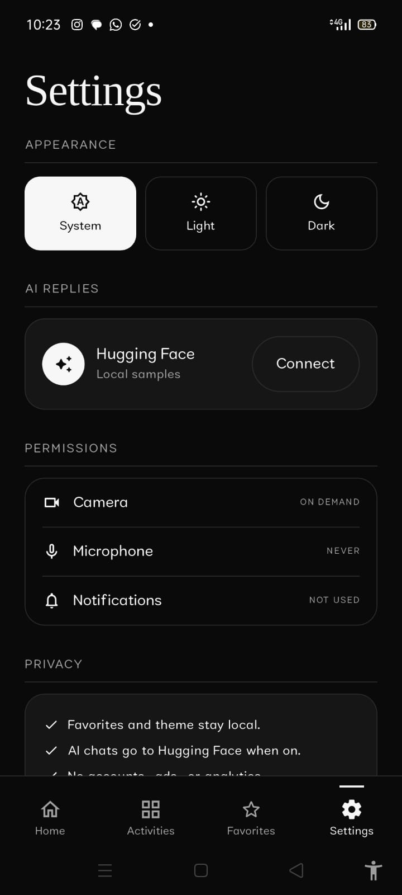
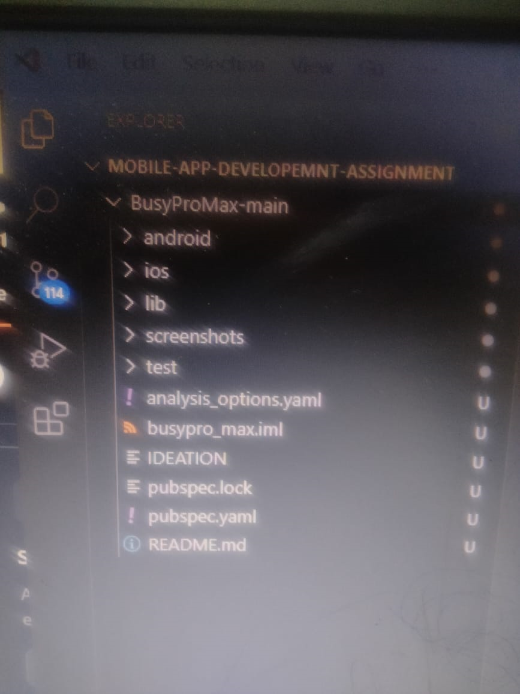

# BusyProMax - React Native Setup

**Course:** Mobile Application Development (Assignment 1)
**University:** University of Management and Technology (UMT), Lahore
**Student:** Maliha
**Instructor:** M. Shahbaz Ali

## Overview

This repository contains a React Native project created with the React Native CLI and run on the Android Emulator, along with screenshots as proof of a successful setup.

## Proof of Setup

| File | Description |
|------|-------------|
| `emulator-proof.png` | App running on the Android Emulator (default React Native welcome screen) |
| `structure-proof.png` | Project file structure visible in VS Code |

### Emulator


### Project Structure


## How the Project Was Created

```bash
npx @react-native-community/cli init BusyProMax
cd BusyProMax
code .
npx react-native run-android
```

## Environment

- Node.js (LTS)
- JDK 17
- Android Studio with an Android Virtual Device (AVD)
- VS Code
- React Native (CLI, TypeScript template)

## Run Locally

```bash
npm install
npx react-native start
# in a second terminal
npx react-native run-android
```
